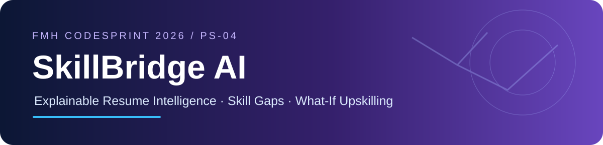
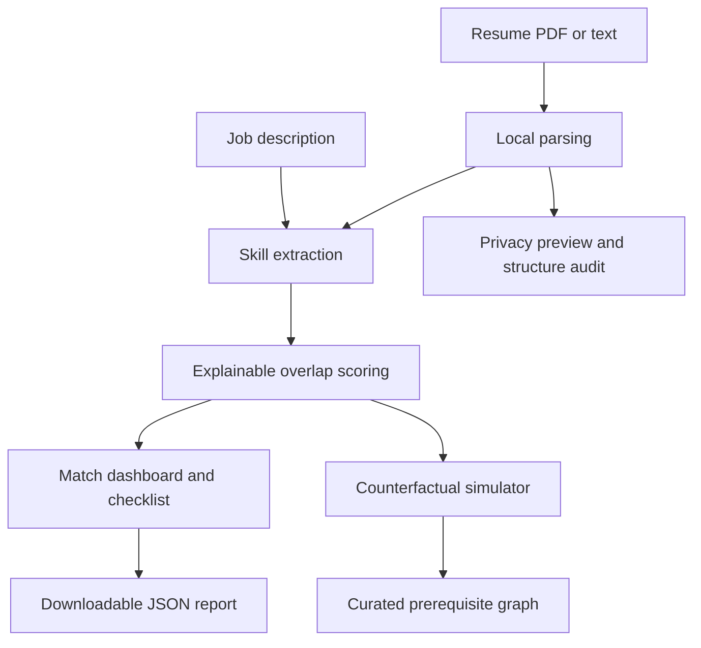

<div align="center">



# 🧠 SkillBridge AI

### See the evidence. Understand the gap. Simulate your next skill.

**FMH CodeSprint Mini Hackathon 2026 · Official Problem PS-04 — AI Resume Analyzer**

   

**[Problem](#-problem) · [Solution](#-solution) · [Features](#-implemented-features) · [Run locally](#-run-locally) · [Submission](SUBMISSION.md)**

</div>

> **Participant/team:** Add your name(s) here before submitting.  
> **GitHub repository:** Add your actual GitHub URL after upload.  
> **Live app:** Add your deployed URL when available in Phase 2.

## 🎯 Problem

Students and job seekers often cannot tell whether their resumes clearly demonstrate the skills required by a particular role. Generic scores offer little explanation or practical next steps.

**Official PS-04 objective:** Build a resume-review tool that extracts relevant information and gives explainable suggestions based on a target job or job description.

## 💡 Solution

SkillBridge AI is a privacy-conscious resume analysis prototype that identifies skills, measures transparent job-skill coverage, audits resume structure, and simulates the effect of *hypothetically* gaining missing skills. Results are guidance, **not** ATS certification or a hiring prediction.

## ✨ Implemented features

| Feature | What it does | Status |
|---|---|---|
| 📄 Resume intake | Editable text or text-based PDF/TXT, 5 MB maximum | Implemented |
| 🔒 Blind preview | Best-effort masking of emails, phone-like strings and URLs | Implemented |
| 🧩 Skill extraction | Curated technical skill vocabulary and aliases | Implemented |
| 📊 Explainable score | Equal-weight recognized job-skill coverage | Implemented |
| 📝 Resume structure | Detects common headings and suggests improvements | Implemented |
| 🚀 What-if simulator | Recalculates coverage after hypothetical skill additions | Implemented |
| 🕸️ Competency graph | Displays curated learning dependencies | Implemented |
| 📥 Report export | Download analysis JSON | Implemented |
| 🧠 Transformer semantic similarity | Optional MiniLM contextual evidence (separate from score) | Optional; needs extra install and model download |
| 📈 Experience-depth scoring | Evidence-linked scoring and evaluation | Planned for Phase 2 |

**Important:** This Phase 1 MVP is rule-based explainable NLP, not yet a hybrid transformer model. Optional MiniLM is available via `requirements-semantic.txt` and the sidebar toggle. It is not enabled by default to keep the first demo reliable.

## 🧮 How the score works

```text
recognized_job_skills = skills extracted from the job description
matched_skills = recognized_job_skills ∩ skills extracted from the resume
coverage = 100 × |matched_skills| / |recognized_job_skills|
```

If the job has no recognized skills, coverage is **N/A**, not zero. The simulator recomputes the same formula after adding selected hypothetical skills. It does not claim that the user has acquired those skills.

## 🏗️ Architecture



## 🧰 Tech stack

Python 3.10+, Streamlit, PyMuPDF, NetworkX, Plotly, pytest. No database or API key required. All resume analysis is performed in the running application; no dedicated persistence layer is implemented.

## 🚀 Run locally

```bash
git clone https://github.com/YOUR_USERNAME/skillbridge-ai.git
cd skillbridge-ai
python -m venv .venv
```

Activate your environment: **Windows** `.venv\Scripts\activate`; **macOS/Linux** `source .venv/bin/activate`.

```bash
pip install -r requirements.txt
streamlit run app.py
```

To test: `python -m pytest -q`.

## 🧪 Sample walkthrough

1. Copy `samples/resume.txt` into the resume field.
2. Copy `samples/job.txt` into the job description field.
3. Click **Analyze resume**.
4. Inspect the matched skills and suggestions in **Explainable Match**.
5. Toggle missing skills in **Upskilling Simulator** to see recalculated coverage.
6. Examine the curated dependency graph and download your JSON report.

## 📸 Screenshots

Add **real screenshots of the running application** before final submission. The banner above is repository artwork, not a screenshot of the deployed app.

## 🔐 Privacy, fairness and limitations

- No user accounts, resume database or third-party LLM API in this MVP.
- Masking is **best effort** and may miss names, addresses and other identifiers. Do not publish real resumes in the repository.
- Skill mentions are not proof of competence. The tool may miss synonyms or misinterpret context.
- Scanned/image-only PDFs are not supported.
- The dependency graph is an educational approximation, not a universal curriculum.
- The score measures extracted skill coverage only; it does not estimate employability or recruitment outcomes.

## 🧪 Testing

Automated tests cover extraction and score arithmetic, missing inputs, privacy masking, counterfactual consistency and curated dependencies. Run `python -m pytest -q`. Also manually test PDF upload and the live deployed app before Phase 2.

## 🤖 AI and third-party attribution

Code, design, documentation and project planning were created with assistance from **OpenAI ChatGPT**. The submitting participant must review, understand, test and adapt this work and follow the hackathon's originality and disclosure requirements. Streamlit, PyMuPDF, NetworkX, Plotly and pytest are third-party open-source libraries. The skill vocabulary and prerequisite mappings are curated demonstration data, not validated occupational standards.

## 🔭 Phase 2 roadmap

- Validate and calibrate optional MiniLM semantic similarity against labeled examples.
- Evidence-linked explanations and validation against labeled example resumes.
- Improve multi-column PDF handling and expand PII masking beyond regex.
- Genuine deployment screenshots, accessible live link, and a rehearsed live demo.

## 📬 Hackathon submission

See **[SUBMISSION.md](SUBMISSION.md)** for beginner-friendly GitHub and Google Form instructions. For Phase 1, the official rulebook asks for **GitHub profile URL + GitHub repository URL**. Phase 2 requires the repository URL and deployed live URL.

## 🧪 Optional semantic mode

Install `pip install -r requirements-semantic.txt` and enable **Optional MiniLM semantic evidence** in the sidebar. The first run downloads model weights and requires network access. This separate cosine-similarity signal is deliberately **not** added to the transparent skill-coverage score; combining scores requires a validated weighting study.

## 📁 Project layout

```text
skillbridge-ai/
├── app.py                    # Streamlit UI
├── engine.py                 # Deterministic skill extraction and feedback
├── advanced.py               # Privacy and score simulation utilities
├── modules/
│   ├── parser.py             # PDF parsing and anonymized preview
│   ├── matcher.py            # Optional semantic analysis
│   ├── graph_engine.py       # Curated directed competency graph
│   └── counterfactual.py     # Ranked what-if actions
├── samples/                  # Synthetic demonstration inputs
├── tests/                    # Automated checks
├── assets/banner.svg         # Repository artwork
├── requirements.txt          # Lightweight default install
├── requirements-semantic.txt # Optional transformer dependencies
└── SUBMISSION.md             # Beginner GitHub instructions
```
